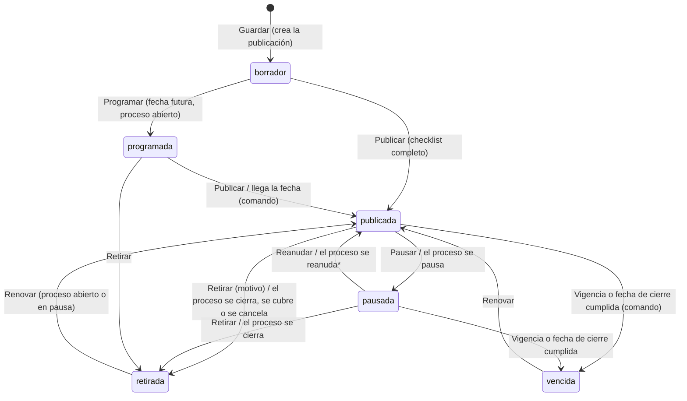

# Flujo de publicación en Agento

La publicación de una oferta en Agento (`agento_publicaciones`) es **1:1 con el proceso de selección** (`seleccion_procesos`). El proceso sigue naciendo de una solicitud de personal aceptada: **no existe «oferta directa»**.

## Estados de la publicación

\* Solo se reanuda sola la pausa que provocó el proceso (`pausada_por = proceso`). Una pausa manual en Agento (`pausada_por = agento`) la levanta una persona con «Reanudar».

Qué ve el público:

| Estado | En `/api/v1` | Postular |
|---|---|---|
| `borrador`, `programada`, `retirada`, `vencida` | No aparece (`404` en el detalle) | n/a |
| `publicada` | Visible | Habilitado |
| `pausada` | Visible, con `status = pausada` y `publicMessage` | **Deshabilitado** |

## Sincronización con el proceso

La publicación sigue al proceso sin modificar el módulo Reclutamiento: `ProcesoObserver` (registrado por `PortalAgentoServiceProvider`) y el comando `agento:sincronizar-publicaciones` (cada 5 minutos) aplican la regla única `FlujoPublicacion::estadoSegunProceso`.

| Cambio en el proceso | Efecto en la publicación |
|---|---|
| `en_pausa` | `pausada` (`pausada_por = proceso`) |
| Reanudar (`abierto`) | `publicada`, solo si la pausa la causó el proceso |
| `cerrado`, `cubierto` o `cancelado` | `retirada` (motivo `proceso_<estado>`) |
| Se retira la publicación desde el flujo actual del proceso (`publicacion_externa = false` o `retirada_at`) | `retirada` |
| `vigente_hasta` o fecha de cierre de postulación cumplida | `vencida` |
| Llega `programada_para` con el proceso abierto | `publicada` (marca la publicación externa del proceso) |
| Cambia cargo, descripción, sueldo, modalidad, confidencialidad… | Se refresca el texto buscable y se invalida la caché pública |

Cada cambio queda en `agento_publicacion_eventos` (solo identificadores y estados). Mientras una acción del panel está en curso, el observer se suspende: la acción ya deja publicación y proceso alineados.

## Efecto de las acciones sobre el proceso

| Acción | Proceso |
|---|---|
| `publicar` / `renovar` con el proceso en borrador | Se abre con `ProcesoService::publicar` (valida el perfil y deja su bitácora) con publicación externa |
| `publicar` / `renovar` con el proceso abierto o en pausa | Solo se marca la publicación externa y se limpia `retirada_at` |
| `pausar` / `reanudar` en Agento | **No cambia el proceso** |
| `retirar` | `publicacion_externa = false`; `retirada_at` solo si el proceso no sigue publicado internamente |
| `programar` | No cambia el proceso hasta la hora indicada |

## Lista de verificación (obligatoria para publicar, programar y renovar)

Proceso en borrador, abierto o en pausa · empresa activa con el servicio de reclutamiento · perfil con al menos una competencia · plazas disponibles · descripción del puesto · resumen público de 20 o más caracteres · área, nivel, jornada y ubicación · fecha de cierre y vigencia no vencidas · texto de consentimiento vigente. **Informativo:** sueldo visible.

## Publicación directa («Publicar en Agento» en el panel)

Menú: Selección y reclutamiento → **Publicar en Agento** (`/seleccion/publicar-agento`).

Un solo formulario crea el puesto sin pasar por solicitud → aceptación → proceso → pestaña:

1. `POST /api/seleccion/agento/puestos` crea la solicitud, la envía y la acepta (con su proceso y plazas), guarda
   la publicación en Agento y, si `publicar=true`, la publica. Todo en **una transacción**: si el checklist falla,
   no queda nada a medias. Reutiliza `SolicitudService` y `PublicacionService`; el ATS no cambia.
2. `GET|PUT /api/seleccion/agento/empresa` lee y guarda el perfil público de la empresa activa (sector, tamaño,
   descripción, sitio web). El nombre sale de la empresa; el slug es estable.
3. `GET /api/seleccion/agento/puestos` lista los puestos de la empresa activa con su estado en Agento.

Permisos: crear el puesto exige `seleccion.solicitudes.crear`, `seleccion.solicitudes.decidir` y
`seleccion.vacantes.gestionar` (hoy los reúnen el administrador y Talento y Cultura). La empresa sale del JWT,
nunca del request. Crear una empresa nueva sigue haciéndose en Configuraciones → Empresas (el administrador es
global; para publicar por otra empresa se cambia de empresa activa).

Sin tablas ni migraciones nuevas: no cambia datos existentes ni Nóminas.
